# 案例图库

每个案例：**上为构建代码，下为点阵预览图**（PNG 位于 [`images/`](images/)，纳入 Git）。

源码：`my-tspl-test` → `scenario` 包（`AllInOneLabelTest` / `LabelStyleScenariosTest`）。

刷新图片（改版面后执行）：

```bash
./scripts/refresh-example-images.sh
```

---

## 综合样张

### 00 · 10×10cm 全能标签（300dpi）

文字、框线、表格、QR、条码、图片阈值/抖动、密集字段、机内 TEXT 混排。版面按 203dpi 点坐标设计，经 `label.dots(...)` 换算到目标 DPI。

```java
TsplLabel label = TsplLabel.create().dpi(300);
byte[] logo = logoPng(label.dots(72), label.dots(36));
byte[] gradient = gradientPng(label.dots(100), label.dots(40));

TsplDocument doc = label
        .standardHeaderMm(100, 100)
        .speed(4)
        .density(8)
        .box(label.dots(16), label.dots(16), label.dots(784), label.dots(784), 3)
        .textBitmap(label.dots(28), label.dots(28), "综合样张 10×10cm",
                TextStyle.bold(label.dots(36)))
        .textBitmap(label.dots(28), label.dots(72),
                "文字·框线·QR·条码·图片·密集字段·机内TEXT",
                TextStyle.plain(label.dots(16)))
        .image(label.dots(640), label.dots(28), logo, ImageOptions.maxWidth(label.dots(120)))
        .hline(label.dots(16), label.dots(88), label.dots(768), 2)
        // … 表格 / QR / 条码 / 图片变体 / 密集字段 / 机内 TEXT …
        .qrcode(label.dots(420), label.dots(270),
                QrOptions.of("M", label.dots(5)), "ALL-IN-ONE-10CM")
        .barcode(label.dots(420), label.dots(400), "128",
                label.dots(36), 1, 0, 2, 4, "SKU77881234")
        .print(1, 1)
        .build();
```

完整版面见 [`AllInOneLabelTest#buildAllInOneLabel`](../../my-tspl-test/src/test/java/tech/muyi/tspl/scenario/AllInOneLabelTest.java)。

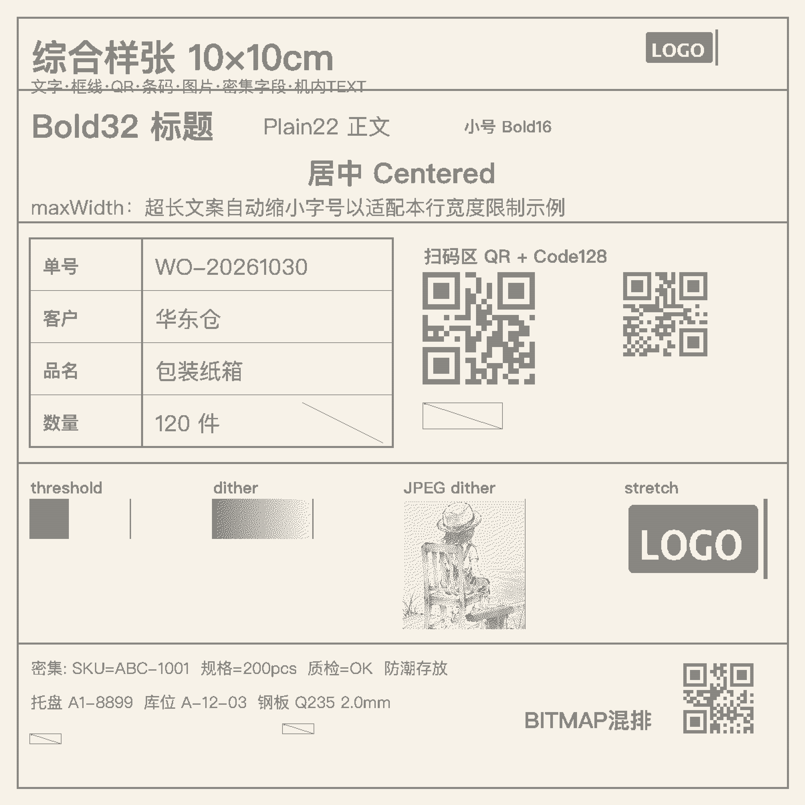

可选实机：`-Dtspl.printer.host=` / 环境变量 `TSPL_PRINTER_HOST`

---

## 样式场景

### 01 · 文字样式

```java
int w = 480;
TsplDocument doc = TsplLabel.create()
        .standardHeaderMm(60, 50)
        .box(8, 8, w - 8, 380, 2)
        .textBitmap(20, 20, "标题 Bold 48", TextStyle.bold(48))
        .hline(20, 80, w - 40, 2)
        .textBitmap(20, 100, "正文 Plain 28 — 普通字重", TextStyle.plain(28))
        .textBitmap(20, 150, "小号 Bold 18 适合字段名", TextStyle.bold(18))
        .textBitmap(20, 190, "大号 Bold 64", TextStyle.bold(64))
        .textBitmapCentered(280, "居中标题 Centered", TextStyle.bold(36), w)
        .textBitmap(20, 340, "maxWidth 收窄：超长文案会被缩小字号适配宽度限制",
                TextStyle.plain(28).maxWidth(400))
        .print(1)
        .build();
```

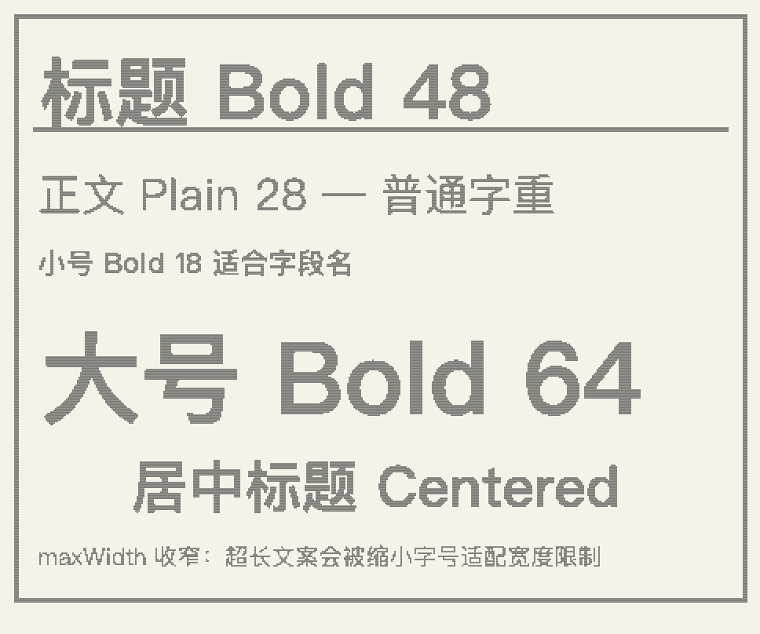

---

### 02 · 表格框线

```java
int left = 16, top = 16, right = 624, bottom = 464;
int col = 220, row1 = 90, row2 = 200, row3 = 320;

TsplDocument doc = TsplLabel.create()
        .standardHeaderMm(80, 60)
        .box(left, top, right, bottom, 3)
        .hline(left, row1, right - left, 2)
        .hline(left, row2, right - left, 2)
        .hline(left, row3, right - left, 2)
        .vline(col, top, bottom - top, 2)
        .vline(420, row1, bottom - row1, 2)
        .textBitmap(left + 12, top + 20, "表格样式 / Table", TextStyle.bold(36))
        .textBitmap(left + 12, row1 + 20, "字段 A", TextStyle.bold(22))
        .textBitmap(col + 12, row1 + 20, "VALUE-A-001", TextStyle.plain(28))
        .textBitmap(left + 12, row2 + 20, "字段 B", TextStyle.bold(22))
        .textBitmap(col + 12, row2 + 20, "仓库-东区", TextStyle.plain(28))
        .textBitmap(left + 12, row3 + 20, "备注", TextStyle.bold(22))
        .textBitmap(col + 12, row3 + 20, "斜线装饰", TextStyle.plain(24))
        .line(420, row3, right, bottom, 1)
        .print(1)
        .build();
```

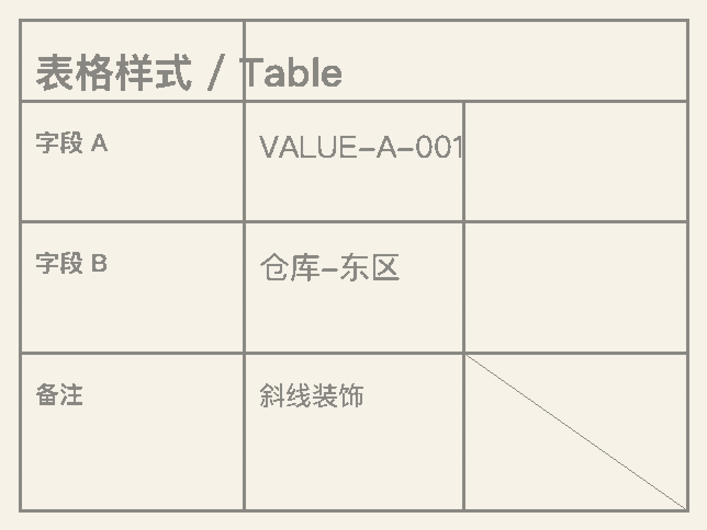

---

### 03 · 二维码 + 条码

```java
TsplDocument doc = TsplLabel.create()
        .standardHeaderMm(70, 50)
        .box(12, 12, 548, 388, 2)
        .textBitmap(24, 24, "扫码区", TextStyle.bold(32))
        .hline(24, 70, 500, 2)
        .qrcode(40, 100, QrOptions.of("L", 6), "https://example.com/item/SKU-7788")
        .qrcode(220, 100, QrOptions.of("M", 5).rotation(90), "ROT-90")
        .barcode(40, 280, "128", 80, 1, 0, 2, 4, "SKU77881234")
        .textBitmap(40, 370, "Code128 + 双二维码", TextStyle.plain(20))
        .print(1)
        .build();
```

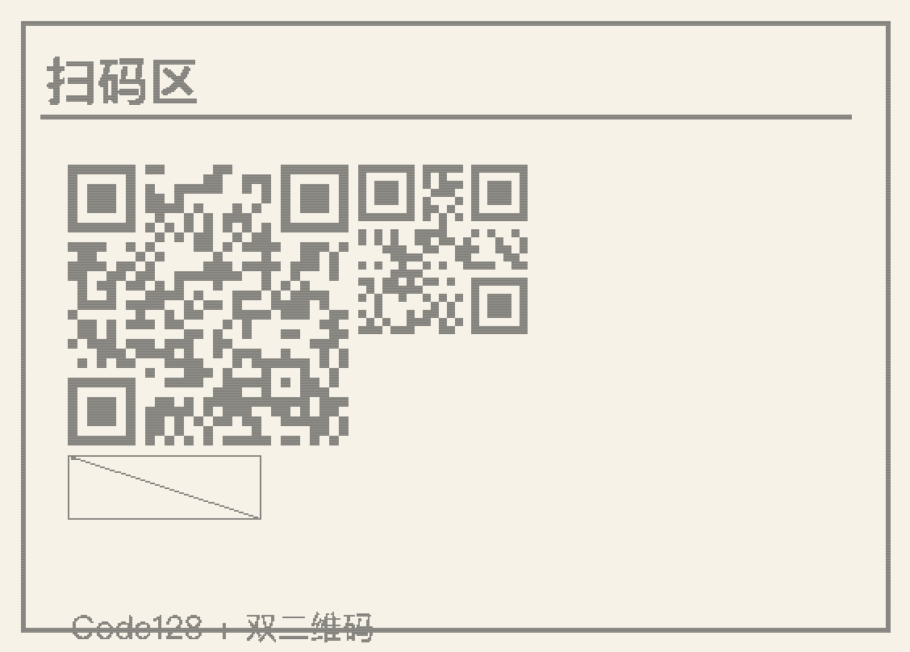

---

### 04 · 图片阈值 vs 抖动

```java
byte[] gradient = gradientPng(120, 60); // 灰度渐变 PNG
byte[] logo = logoPng(80, 40);         // 简易 LOGO PNG

TsplDocument doc = TsplLabel.create()
        .standardHeaderMm(70, 45)
        .textBitmap(16, 12, "图片阈值 vs 抖动", TextStyle.bold(28))
        .hline(16, 52, 520, 1)
        .textBitmap(16, 64, "threshold=100", TextStyle.plain(18))
        .image(16, 90, gradient, ImageOptions.maxWidth(200).threshold(100))
        .textBitmap(280, 64, "dither=true", TextStyle.plain(18))
        .image(280, 90, gradient, ImageOptions.maxWidth(200).dither(true))
        .textBitmap(16, 180, "Logo keepAspect", TextStyle.plain(18))
        .image(16, 210, logo, ImageOptions.maxSize(160, 80))
        .textBitmap(280, 180, "Logo stretch", TextStyle.plain(18))
        .image(280, 210, logo, ImageOptions.maxSize(160, 80).keepAspect(false))
        .print(1)
        .build();
```

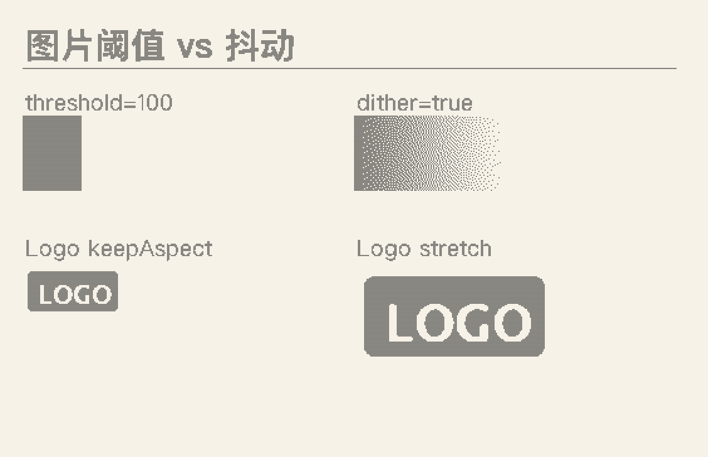

---

### 05 · WMS 托盘标签

```java
byte[] logo = logoPng(64, 32);
String traycode = "B3-8899";

TsplDocument doc = TsplLabel.create()
        .standardHeaderMm(100, 80)
        .box(20, 20, 780, 620, 3)
        .hline(20, 100, 760, 2)
        .textBitmap(40, 40, "铁托盘", TextStyle.bold(48))
        .image(520, 36, logo, ImageOptions.maxWidth(120))
        .textBitmap(40, 130, "托盘号", TextStyle.bold(22))
        .textBitmap(40, 170, traycode, TextStyle.bold(72))
        .hline(20, 280, 760, 2)
        .textBitmap(40, 310, "库位", TextStyle.bold(22))
        .textBitmap(40, 350, "A-12-03", TextStyle.plain(40))
        .textBitmap(40, 420, "物料", TextStyle.bold(22))
        .textBitmap(40, 460, "钢板 Q235 2.0mm", TextStyle.plain(32))
        .qrcode(560, 320, QrOptions.of("L", 10), traycode)
        .textBitmap(560, 560, traycode, TextStyle.plain(20))
        .print(1)
        .build();
```

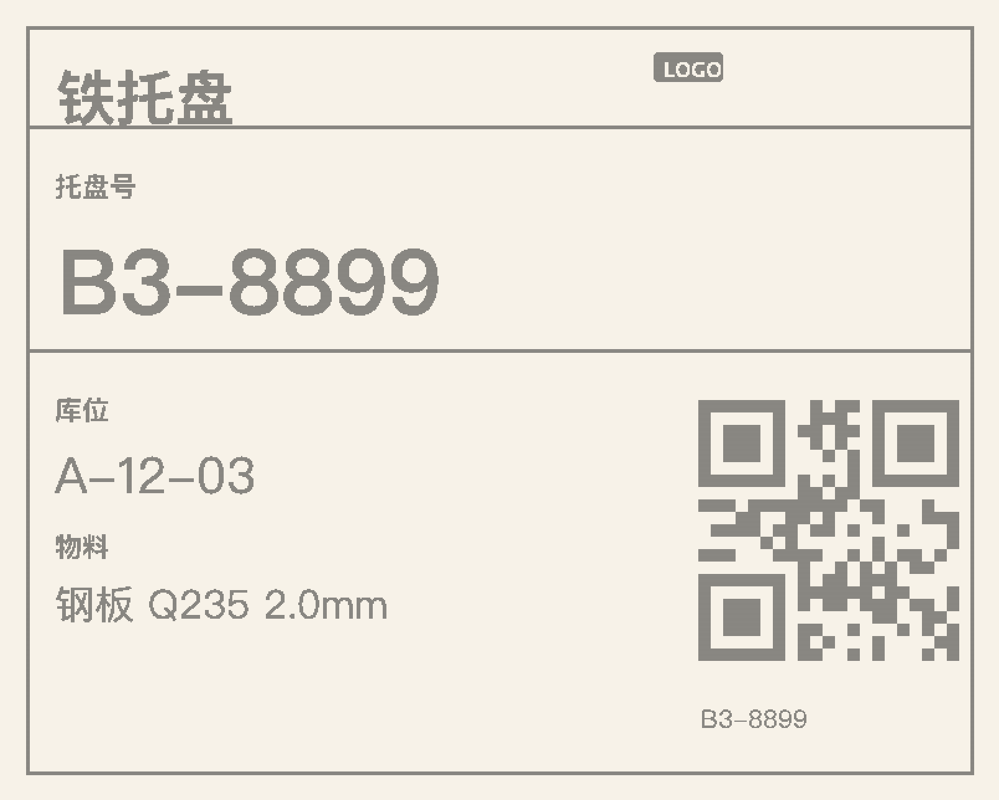

---

### 06 · 快递面单

```java
TsplDocument doc = TsplLabel.create()
        .standardHeaderMm(100, 70)
        .box(16, 16, 784, 544, 3)
        .box(16, 16, 784, 100, 2)
        .textBitmapCentered(36, "快递面单 / SHIPPING", TextStyle.bold(40), 800)
        .textBitmap(32, 120, "收件人", TextStyle.bold(20))
        .textBitmap(32, 155, "张三  138****0000", TextStyle.bold(32))
        .textBitmap(32, 210, "地址", TextStyle.bold(20))
        .textBitmap(32, 245, "浙江省杭州市余杭区文一西路xxx号",
                TextStyle.plain(26).maxWidth(480))
        .textBitmap(32, 300, "某某科技园 3 号楼 501", TextStyle.plain(26))
        .vline(540, 100, 300, 2)
        .qrcode(560, 130, QrOptions.of("M", 7), "SF1234567890")
        .hline(16, 420, 768, 2)
        .barcode(40, 450, "128", 70, 1, 0, 2, 4, "SF1234567890")
        .print(1)
        .build();
```

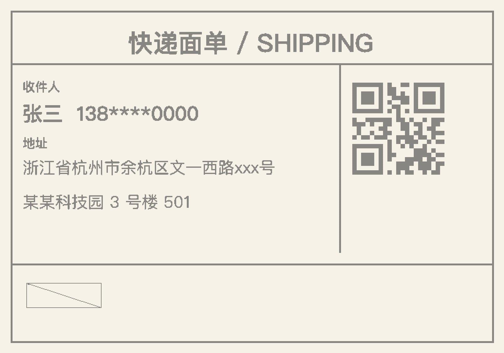

---

### 07 · 价签

```java
// 40×30 mm 小价签
TsplDocument doc = TsplLabel.create()
        .standardHeaderMm(40, 30)
        .box(6, 6, 314, 234, 2)
        .textBitmapCentered(16, "特价", TextStyle.bold(28), 320)
        .hline(6, 56, 308, 1)
        .textBitmap(16, 70, "有机牛奶 1L", TextStyle.plain(22).maxWidth(280))
        .textBitmap(16, 120, "¥12.90", TextStyle.bold(48))
        .barcode(16, 180, "EAN13", 40, 0, 0, 2, 4, "6901234567892")
        .print(1)
        .build();
```

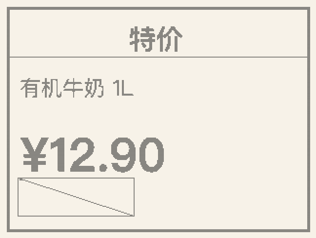

---

### 08 · 表单键值格

```java
int l = 20, r = 620;
int[] rows = {20, 90, 160, 230, 300, 370, 440};
String[] keys = {"单号", "客户", "品名", "数量", "批次", "日期"};
String[] vals = {"WO-20261030-01", "华东仓", "包装纸箱", "120 件", "LOT-88", "2026-10-30"};

TsplLabel label = TsplLabel.create()
        .standardHeaderMm(80, 60)
        .box(l, rows[0], r, rows[rows.length - 1], 3);

for (int i = 0; i < rows.length - 1; i++) {
    label.hline(l, rows[i + 1], r - l, 2);
    label.textBitmap(l + 16, rows[i] + 20, keys[i], TextStyle.bold(24));
    label.textBitmap(200, rows[i] + 18, vals[i], TextStyle.plain(28));
}
label.vline(180, rows[0], rows[rows.length - 1] - rows[0], 2);
label.print(1);

TsplDocument doc = label.build();
```

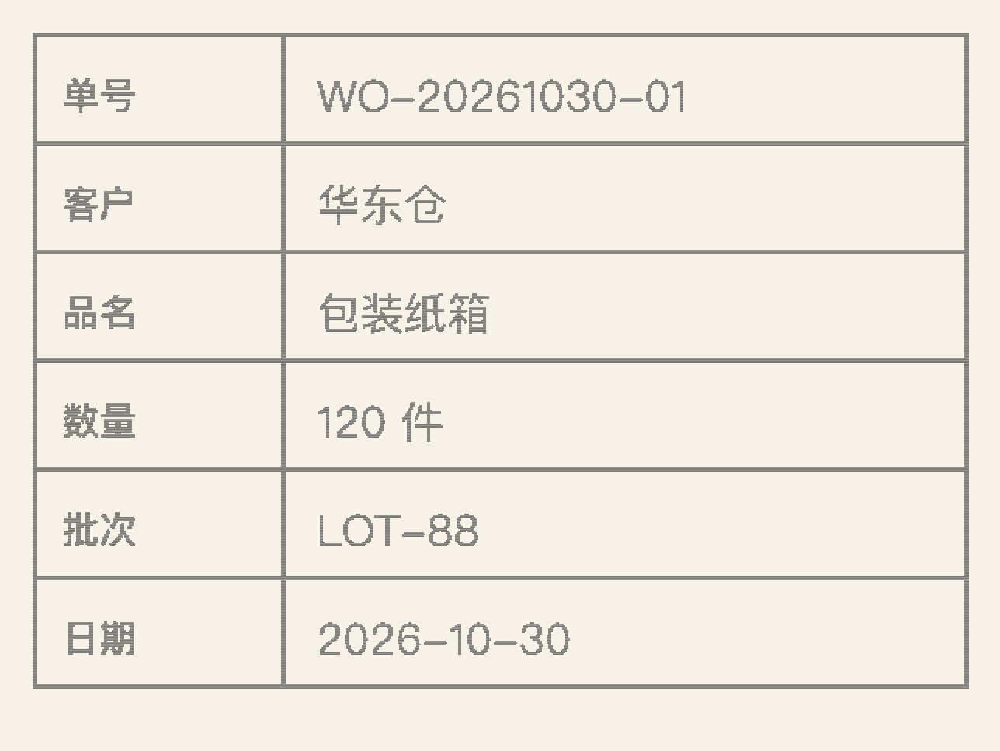

---

### 09 · 密集字段

```java
TsplLabel label = TsplLabel.create()
        .standardHeaderMm(60, 40)
        .box(8, 8, 472, 312, 2)
        .textBitmap(16, 16, "密集字段样例", TextStyle.bold(26))
        .hline(8, 52, 464, 1);

String[] lines = {
        "SKU: ABC-1001-CN",
        "名称: 不锈钢紧固件套装 M6",
        "规格: 200pcs / 盒",
        "供应商: 苏州某某精密件",
        "入库: 2026-10-28  质检: OK",
        "备注: 防潮存放 · 勿压"
};
int y = 64;
for (String line : lines) {
    label.textBitmap(16, y, line, TextStyle.plain(18).maxWidth(440));
    y += 36;
}
label.print(1);

TsplDocument doc = label.build();
```

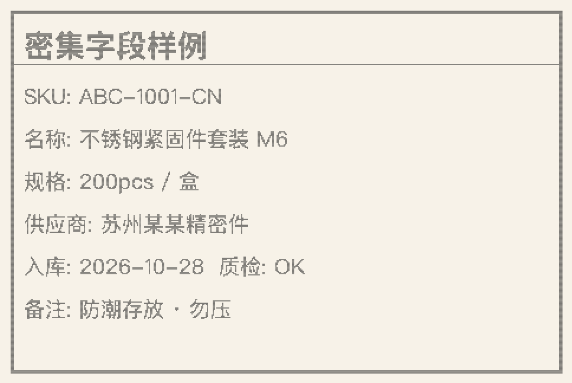

---

### 10 · 机内 TEXT + BITMAP 混排

```java
// 机内 TEXT（预览为占位）+ 服务端 BITMAP 中文混排
TsplDocument doc = TsplLabel.create()
        .standardHeaderMm(50, 40)
        .box(10, 10, 390, 310, 2)
        .text(20, 24, "0", 0, 1, 1, "NATIVE TEXT 0")
        .textBitmap(20, 70, "BITMAP 中文混排", TextStyle.bold(28))
        .hline(10, 120, 380, 1)
        .text(20, 140, "2", 0, 2, 2, "MUL 2x2")
        .textBitmap(20, 220, "下方仍是位图字", TextStyle.plain(22))
        .qrcode(280, 140, QrOptions.of("L", 4), "MIX")
        .print(1)
        .build();
```

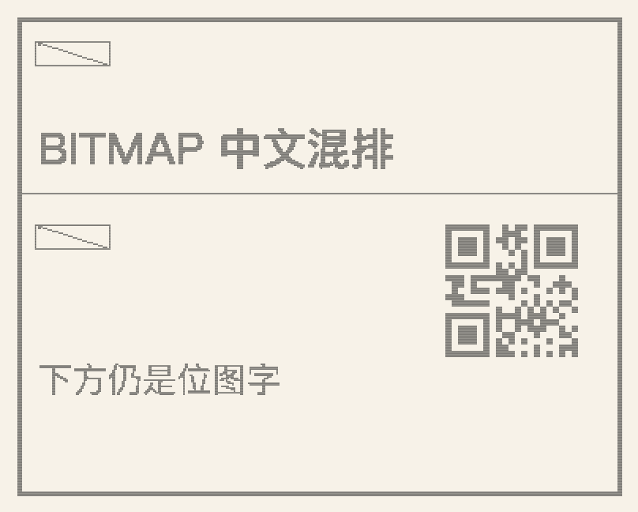
